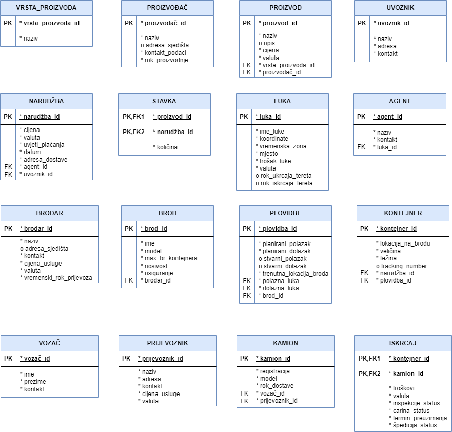

# Logistics Database

A PostgreSQL database project for managing a simplified logistics and shipping workflow.

The database models products and manufacturers, importers and orders, ports and shipping agents, vessels and voyages, containers, carriers, trucks, and deliveries.

## Features

- Relational database schema with primary and foreign keys
- Sample data for testing
- SQL queries using joins, filters, and aggregate functions
- Indexes for commonly queried fields
- Stored procedures for updating shipment and delivery information
- Triggers for enforcing selected business rules
- Entity relationship diagrams

## Database diagram

## Technologies

- PostgreSQL
- SQL
- Draw.io

## Project files

- `logistika_create.sql` — creates the tables and constraints
- `logistika_inserts.sql` — inserts sample data
- `logistika_upiti.sql` — contains example queries, indexes, procedures, and triggers
- `logistika_relacijski.drawio` — editable relational diagram
- `logistika_relacijski.png` — diagram preview

## Getting started

1. Create an empty PostgreSQL database.
2. Run `logistika_create.sql`.
3. Run `logistika_inserts.sql`.
4. Run selected examples from `logistika_upiti.sql`.

Use a test database: some SQL examples update or delete records.

## Example queries

The project includes examples for:

- Tracking a container’s vessel and planned arrival
- Finding deliveries that have passed inspection, customs, and forwarding
- Summarizing ordered quantities by importer
- Calculating sales totals by product
- Counting containers by voyage

## Notes

This is an educational project. The sample records are for demonstration and do not represent a production logistics system.
